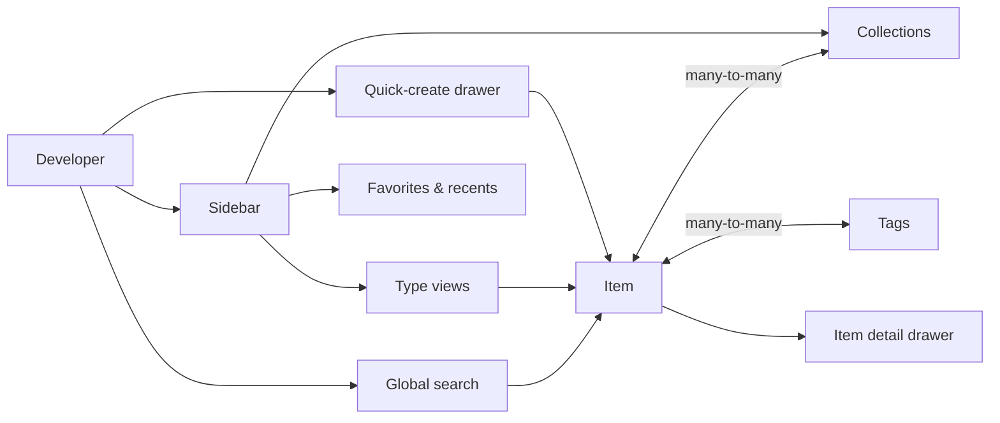
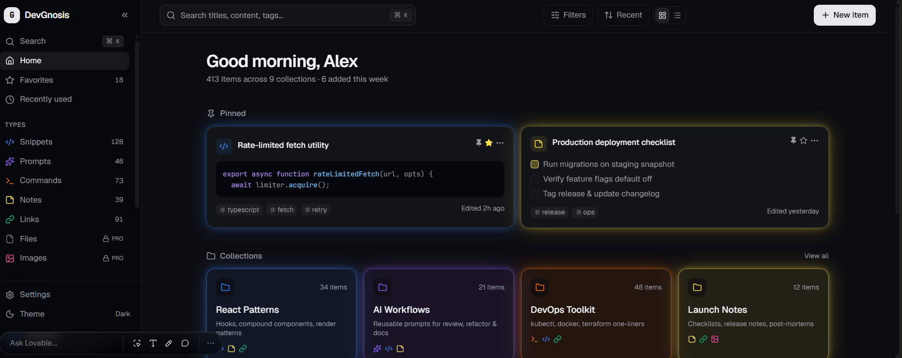
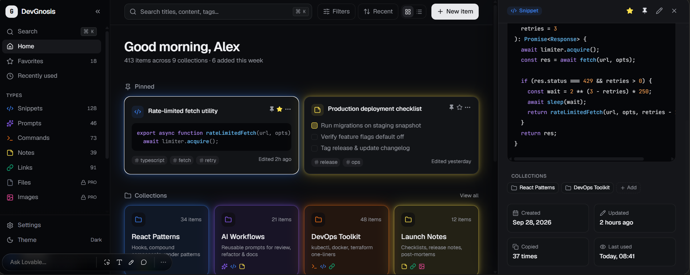
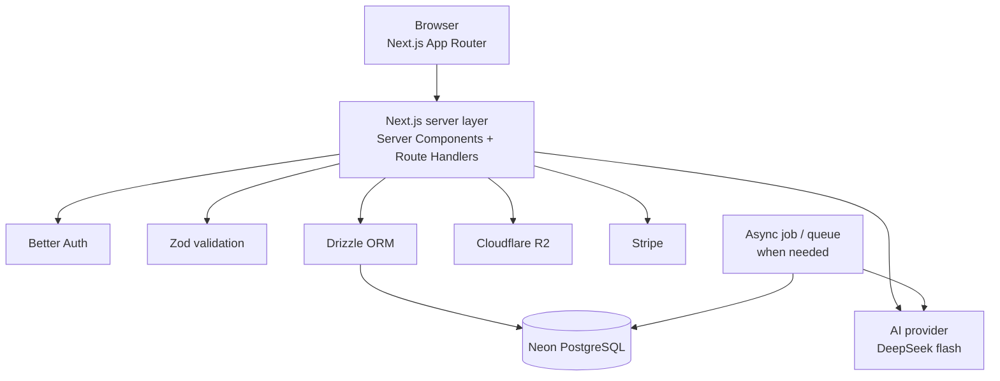
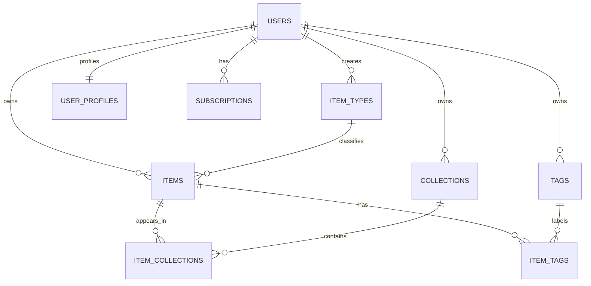
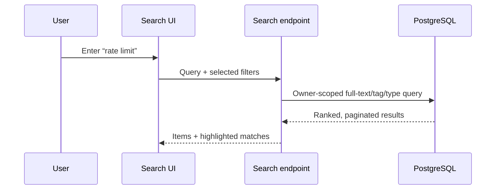

# DevGnosis

> **A developer knowledge hub for the snippets, prompts, commands, context, links, and files that otherwise disappear across tools.**

[Product vision](#product-vision) · [MVP](#mvp-scope) · [Architecture](#architecture) · [Data model](#data-model) · [Roadmap](#delivery-roadmap) · [Coding standards](./coding-standards.md)

---

## Product vision

Developers constantly re-create knowledge because their useful material is fragmented: a snippet in VS Code, a prompt in an AI chat, a command in shell history, a link in bookmarks, and a project brief in a folder. DevGnosis gives each developer one quick, structured, searchable home for that knowledge.

The product should feel like the speed of Raycast, the organization of Notion, and the calm polish of Linear—without becoming a general-purpose document suite.

### Product principles

1. **Capture in seconds.** Creating an item must be possible from anywhere in the app, with very little required metadata.
2. **Retrieve faster than re-creating.** Search, filters, recents, pins, and favorites are first-class flows.
3. **Structure without friction.** An item may live in multiple collections; collections never force duplication.
4. **Useful before intelligent.** The core library is valuable without AI. AI enriches and explains content; it does not gate basic organization.
5. **Developer-native by default.** Markdown, code-aware rendering, keyboard-friendly navigation, dark mode, and portable exports are baseline expectations.

## Who it serves

| Persona                     | Job to be done                          | Example saved knowledge                        |
| --------------------------- | --------------------------------------- | ---------------------------------------------- |
| Everyday developer          | Reuse a reliable bit of work quickly    | Git commands, API links, debug notes           |
| AI-first developer          | Build a reusable prompt/context library | System prompts, agent workflows, repo context  |
| Content creator or educator | Organize examples and explanations      | Course notes, code blocks, teaching links      |
| Full-stack builder          | Keep patterns ready across projects     | Boilerplates, API examples, architecture notes |

## MVP scope

### Core workflows

| Workflow | Outcome                                                                    |
| -------- | -------------------------------------------------------------------------- |
| Capture  | Create a typed text item or link in the global quick-create drawer.        |
| Organize | Add tags and place one item in any number of collections.                  |
| Retrieve | Search titles, content, tags, and type; filter and open an item instantly. |
| Reuse    | Copy code/commands/prompts, open links, or download attached files.        |
| Navigate | Browse type pages, collections, favorites, pinned items, and recents.      |

### System item types

System types are seeded, stable, and cannot be renamed or deleted. Their visual treatment is consistent across the app.

| Type    |     Icon     | Color     | Content mode               | Availability |
| ------- | :----------: | --------- | -------------------------- | ------------ |
| Snippet |  `CodeXml`   | `#3B82F6` | Markdown/code text         | Free         |
| Prompt  |  `Sparkles`  | `#8B5CF6` | Markdown text              | Free         |
| Note    | `StickyNote` | `#FDE047` | Markdown text              | Free         |
| Command |  `Terminal`  | `#F97316` | Plain/code text            | Free         |
| Link    |    `Link`    | `#10B981` | URL + optional description | Free         |
| File    |    `File`    | `#6B7280` | Uploaded file              | Pro          |
| Image   |   `Image`    | `#EC4899` | Uploaded image             | Pro          |

Suggested [Lucide](https://lucide.dev/icons/) icon names are shown above. A type’s content mode, rather than its display name, determines the editor and validation rules.

### Explicitly deferred

The following are valuable, but should not delay a polished library MVP:

- User-defined item types
- AI-generated metadata and writing tools
- Importing from third-party products
- Collaborative/shared collections
- Offline-first support and browser extension capture

## Plans and entitlements

| Capability             | Free | Pro — $5/month |
| ---------------------- | ---: | -------------: |
| Total items            |   50 |      Unlimited |
| Collections            |    5 |      Unlimited |
| Text and link types    |  Yes |            Yes |
| File and image uploads |    — |            Yes |
| Basic search           |  Yes |            Yes |
| AI enrichment          |    — |            Yes |
| Export (JSON / ZIP)    |    — |            Yes |
| Priority support       |    — |            Yes |

During development, enable an **entitlement bypass** only in non-production environments. Production API routes—not just the interface—must enforce quotas and Pro-only features.

## Information architecture



### Routes

| Route                 | Purpose                                                 |
| --------------------- | ------------------------------------------------------- |
| `/`                   | Personalized home: pinned, recent, and favorite content |
| `/items/[type]`       | Filtered type view, e.g. `/items/snippets`              |
| `/collections`        | All collections                                         |
| `/collections/[slug]` | Collection detail and its items                         |
| `/search`             | Full search results with URL-backed filters             |
| `/settings`           | Profile, appearance, account, billing, export           |

Use a stable `slug` for navigable collection URLs. Never derive permissions from slugs or client-side filters.

## UX direction

- **Default theme:** dark; provide a persistent light-mode preference.
- **Shell:** collapsible desktop sidebar; mobile drawer below the desktop breakpoint.
- **Content:** responsive card/list view. Collection cards use the dominant item type color as a subtle tint; item cards use the type color as an accent, not a saturated background.
- **Detail:** an item opens in a side drawer for quick reading, copy, editing, tagging, and collection management. Deep links should still open a full-page fallback on small screens.
- **Feedback:** optimistic updates where safe, undoable toasts for removal, loading skeletons, visible keyboard focus, and reduced-motion support.
- **Code:** syntax highlighting, language label, one-click copy, and preserved whitespace.

## Design references

These approved UI mockups guide implementation of the dashboard shell, responsive behavior, collection/item hierarchy, and detail-drawer patterns. They are design references, not exact pixel-for-pixel requirements.

## Design references

The following desktop mockups are the visual baseline for the DevGnosis dashboard. They guide layout, hierarchy, dark-mode treatment, type-color accents, and the item detail experience; implementation should remain responsive and accessible rather than pixel-copying fixed dimensions.

### Dashboard — default state



- Persistent sidebar with navigation, item-type counts, collections, settings, and theme controls.
- Global search and filtering toolbar.
- Pinned items followed by color-accented collection cards.
- Dark, developer-focused interface with restrained glows and syntax-highlighted code.

### Dashboard — item detail drawer



- Selecting an item opens a right-side detail drawer while preserving dashboard context.
- The drawer supports code/content preview, tags, collection membership, metadata, and item actions.
- On mobile, this pattern becomes a full-screen detail sheet.

### Essential keyboard actions

| Shortcut             | Action                           |
| -------------------- | -------------------------------- |
| `⌘/Ctrl + K`         | Search or command palette        |
| `C`                  | New item (when not editing text) |
| `⌘/Ctrl + Enter`     | Save item                        |
| `Esc`                | Close drawer or dialog           |
| `⌘/Ctrl + Shift + C` | Copy current item content        |

## Architecture



### Recommended stack

- [Next.js](https://nextjs.org/) with React and TypeScript; use Server Components for reading and client components only for interactive surfaces.
- [Tailwind CSS](https://tailwindcss.com/) v4 and [shadcn/ui](https://ui.shadcn.com/) for accessible primitives and app-specific composition.
- [Neon](https://neon.com/) PostgreSQL with [Drizzle ORM](https://orm.drizzle.team/); schema changes go through versioned migrations only.
- [Better Auth](https://www.better-auth.com/) for email/password and GitHub/Google OAuth. Keep its generated/managed tables separate from application profile data.
- [Cloudflare R2](https://www.cloudflare.com/developer-platform/products/r2/) for binary objects. Store object keys and metadata in Postgres, not a public URL as the source of truth.
- Stripe for billing and subscription webhooks.
- Zod schemas shared by forms, server actions/route handlers, and AI tool inputs.

**Migration rule:** never use `db push` against shared or production databases. Generate reviewed Drizzle migrations, apply them in development/CI, then promote the same migrations to production.

### Environments

One Neon branch per environment, mapped to the matching Vercel environment scope.

| Environment | Neon branch | Where the URL lives | Notes |
| --- | --- | --- | --- |
| Local development | `development` | `.env` on the developer machine | Seeded with the demo user |
| Vercel Preview | `preview` | Vercel → Preview scope | Email/password only; OAuth callbacks are not registered for preview URLs |
| Vercel Production | `production` | Vercel → Production scope | Never seeded with demo data |

- Branch a new environment from `production`, not `development`, so previews start from the schema production actually runs.
- Apply the reviewed migration artifact to each branch. A branch missing the latest migration is a bug, not a shortcut.
- Production is the default Neon branch, so stray branch creation and restores default to the safer parent.

### Boundary and security rules

- Derive the authenticated user on the server for every protected request; never accept `userId` from the client.
- Scope every database query by ownership. Collection membership must not make another user’s item readable.
- Issue short-lived, user-authorized R2 upload/download URLs; validate MIME type and byte size server-side.
- Store raw file object keys, not permanent public links. Delete associated objects as part of a controlled item-deletion workflow.
- Verify Stripe webhook signatures and treat Stripe as the billing-event source; update entitlements idempotently.
- Rate-limit authentication, upload, search, export, and AI endpoints. Log AI usage without persisting secrets from prompts unnecessarily.

## Data model

### Relationship diagram



### Model decisions

| Model              | Key fields and constraints                                                                                                                              |
| ------------------ | ------------------------------------------------------------------------------------------------------------------------------------------------------- |
| `users`            | Auth-managed identity only (`user`, `session`, `account`, `verification` are generated by Better Auth and kept distinct from app data). Do not use a mutable `isPro` boolean as the only entitlement record. |
| `user_profiles`    | 1:1 with `user` (keyed by `user_id`): `display_name`, `plan`, `plan_status`, `stripe_customer_id`. App-owned entitlement mirror; the authoritative billing state is `subscriptions`. |
| `item_types`       | `id`, `owner_id` nullable, `key`, `name`, `icon`, `color`, `content_kind`, `is_system`. System keys are unique; custom type names are unique per owner. |
| `items`            | Owner, item type, title, description, `content`, `url`, optional file metadata, language, `is_favorite`, `is_pinned`, timestamps, and `last_opened_at`. |
| `collections`      | Owner, unique per-owner `slug`, name, optional description, `is_favorite`, optional `default_type_id`, timestamps.                                      |
| `item_collections` | Composite primary key of `item_id` and `collection_id`; includes `added_at`. Both referenced records must belong to the same user.                      |
| `tags`             | Owner plus a normalized name; unique on `(owner_id, normalized_name)`.                                                                                  |
| `item_tags`        | Composite primary key of `item_id` and `tag_id`.                                                                                                        |
| `subscriptions`    | Provider customer/subscription IDs, plan, status, period end, and webhook/audit timestamps.                                                             |

Items use nullable content fields because they support three mutually exclusive storage modes. Enforce the valid combination in application validation and, where practical, database `CHECK` constraints:

| `content_kind` | Required item fields                                       | Must be empty      |
| -------------- | ---------------------------------------------------------- | ------------------ |
| `text`         | `content`                                                  | file fields, `url` |
| `url`          | `url`                                                      | file fields        |
| `file`         | `storage_key`, `file_name`, `mime_type`, `file_size_bytes` | `content`, `url`   |

### Drizzle-oriented schema sketch

This is an implementation guide, not a generated migration. Define it in the project’s Drizzle schema files and generate a reviewed migration from it.

```ts
export const items = pgTable("items", {
  id: uuid("id").defaultRandom().primaryKey(),
  ownerId: text("owner_id").notNull().references(() => users.id),
  itemTypeId: uuid("item_type_id").notNull().references(() => itemTypes.id),
  title: varchar("title", { length: 160 }).notNull(),
  description: text("description"),
  content: text("content"),
  url: text("url"),
  storageKey: text("storage_key"),
  fileName: text("file_name"),
  mimeType: varchar("mime_type", { length: 255 }),
  fileSizeBytes: bigint("file_size_bytes", { mode: "number" }),
  language: varchar("language", { length: 80 }),
  isFavorite: boolean("is_favorite").notNull().default(false),
  isPinned: boolean("is_pinned").notNull().default(false),
  lastOpenedAt: timestamp("last_opened_at", { withTimezone: true }),
  createdAt: timestamp("created_at", { withTimezone: true }).notNull().defaultNow(),
  updatedAt: timestamp("updated_at", { withTimezone: true }).notNull().defaultNow(),
}, (table) => [
  index("items_owner_updated_idx").on(table.ownerId, table.updatedAt),
  index("items_owner_type_idx").on(table.ownerId, table.itemTypeId),
]);
```

## Search and performance

Start with PostgreSQL full-text search using a generated `tsvector` over title, description, and text content, with a GIN index. Combine it with exact/partial tag matching and scoped type filters. Every query begins with `owner_id`.



Use cursor pagination for large libraries. Redis is not an MVP dependency; introduce it only after measured pressure on a read-heavy path or rate-limiting requires it.

## AI features (Pro)

AI enriches a saved item after the primary save succeeds. It should be cancelable, observable, and safe to retry.

| Feature              | Input                  | Output                      | Guardrail                                |
| -------------------- | ---------------------- | --------------------------- | ---------------------------------------- |
| Auto-tag suggestions | Title + item body      | Suggested existing/new tags | User reviews before applying             |
| Summary              | Long text              | Concise summary             | Preserve source; label generated content |
| Explain code         | Code + language        | Explanation and caveats     | Never execute submitted code             |
| Prompt optimizer     | Prompt + optional goal | Revised prompt and diff     | Keep original; user applies explicitly   |

The current planned model is `deepseek-flash` (confirm the deployed provider/model identifier at integration time). Send only the minimal user-authorized content necessary, enforce input/output limits, and meter usage by user for cost controls.

## Delivery roadmap

### Phase 0 — foundation

- Initialize Next.js, Tailwind, shadcn/ui, linting, formatting, environment validation, and CI.
- Configure Better Auth, Neon, Drizzle migrations, seed system item types, and R2 client.
- Establish server-side ownership helpers, Zod schemas, error taxonomy, and test fixtures.

### Phase 1 — library MVP

- Text/link item CRUD, item-type views, Markdown editing, syntax highlighting, copy actions.
- Collections, tags, many-to-many assignment, favorites, pins, and recently opened items.
- Sidebar, responsive layouts, quick-create/detail drawer, search, and dark/light themes.

### Phase 2 — product readiness

- File/image upload flow, signed R2 URLs, content validation, and safe download/delete behavior.
- Stripe checkout/customer portal/webhooks and production plan enforcement.
- JSON export and account-data deletion/export paths.

### Phase 3 — intelligence and growth

- AI enrichment jobs and usage controls.
- ZIP export, import, custom item types, browser/IDE capture, and optional sharing based on validated demand.

## Acceptance checks for the MVP

- A signed-in user can create, edit, delete, pin, favorite, tag, and search text/link items.
- One item can belong to multiple collections without being duplicated.
- A user cannot retrieve or mutate any record, join-table row, or stored object outside their ownership scope.
- Search returns only the current user’s data and supports content, title, tag, and type filters.
- Every system type renders the prescribed icon/color and cannot be altered by end users.
- The primary flows work with keyboard, screen reader labels, narrow mobile screens, and reduced-motion preferences.
- Database changes are represented by reviewed Drizzle migrations; no shared environment relies on `db push`.

## Open decisions to settle before implementation

1. **Editor:** choose a Markdown-first editor/library and define whether rendered HTML is stored (recommended: store Markdown/source only).
2. **File limits:** set allowed MIME types, maximum file size, image transformations, retention, and malware-scanning policy.
3. **Search semantics:** agree on stemming/language support, phrase search, ranking, and whether link descriptions participate.
4. **AI provider contract:** verify model availability, data retention policy, regional requirements, and per-plan usage limits.
5. **Billing geography:** decide currency, tax handling, trials, cancellation behavior, and grandfathered users before Stripe integration.
6. **Deletion policy:** define soft-delete/restore windows versus permanent deletion, including R2 lifecycle cleanup.

---

DevGnosis succeeds when a developer’s answer to “where did I save that?” becomes “DevGnosis—search it.”
